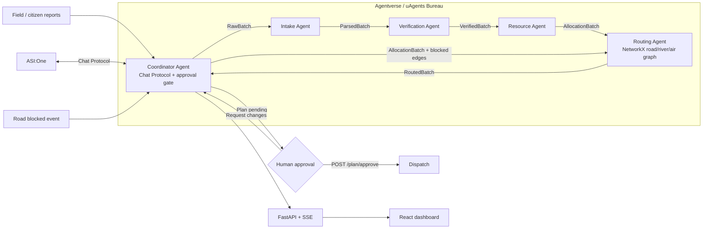

# ReliefMesh AI - Architecture

All data is **simulated**. Decision-support only; a human must approve before any real-world dispatch.

## Message contracts (backend/models.py)
`RawBatch -> ParsedBatch -> VerifiedBatch -> AllocationBatch -> RoutedBatch`; replanning re-sends an
`AllocationBatch` with `blocked` edge ids to the Routing Agent.

## Decision rules
- **Duplicate**: same village (fuzzy) or <=3 km, overlapping need, within 120 min. Headcount ratio >= 0.7 merges, < 0.7 flags a **conflict** (higher figure used, human check advised).
- **Priority**: urgency dominates, then headcount, then confidence.
- **Vehicles**: each vehicle runs sorties sequentially (ETA includes queue time). Fastest ground vehicle goes to the higher priority; others get an alternate (boat via river), are queued, or - if ground completion exceeds 9 h for an urgent site - get the helicopter (last resort). Sites that cannot be served within 24 h are deferred.
- **Approval gate**: `approve_plan()` is the only code path that sets `dispatched=true`. Any replan returns the plan to `pending_approval`.

## Add another region
Copy `data/` to `data_odisha/` (edit the four JSON files) and run with `RELIEF_DATA_DIR=./data_odisha`. No code changes.
